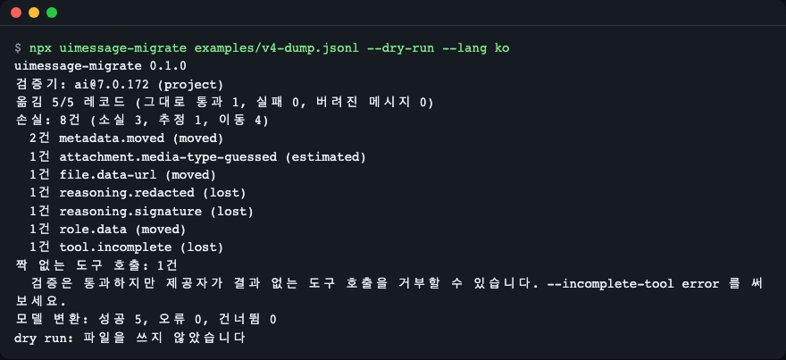
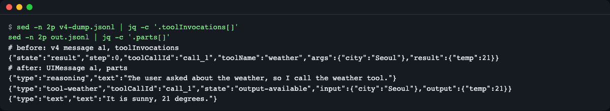
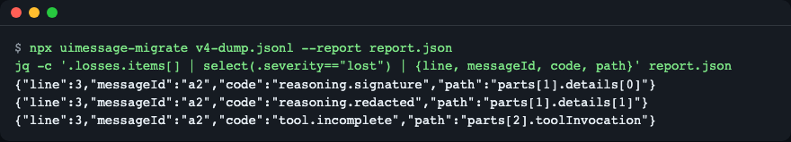
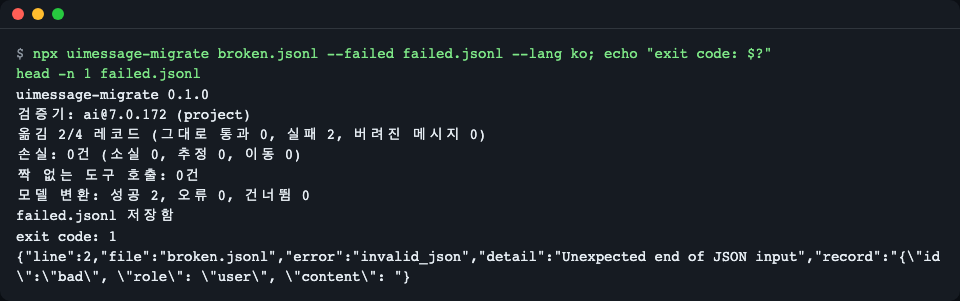
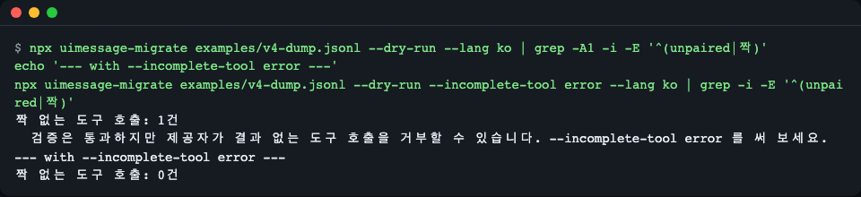
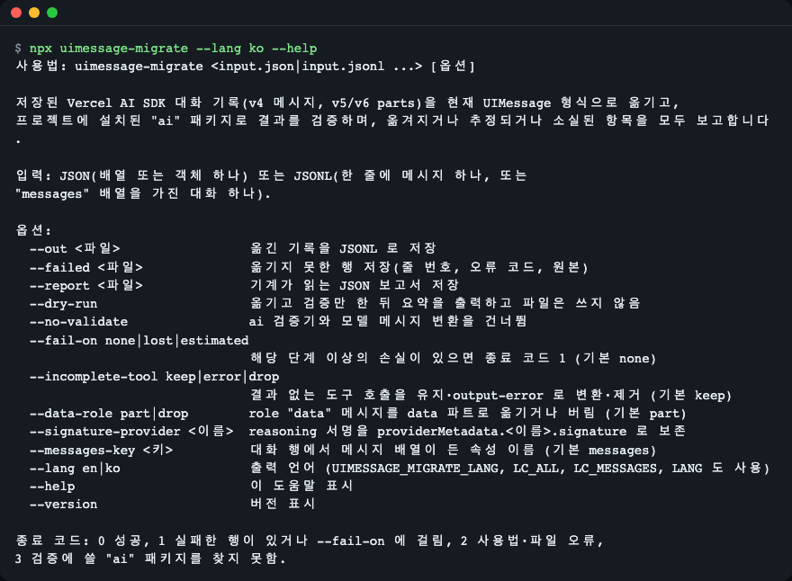
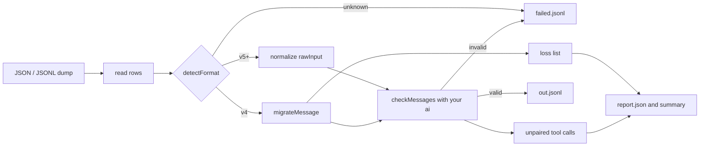

# uimessage-migrate

[English](README.md) | **한국어**

[](https://github.com/LeeGyeongPil/uimessage-migrate/actions/workflows/ci.yml) [](LICENSE)

이전 버전 Vercel AI SDK 가 저장한 대화 기록(4.x 메시지, 또는 v5/v6 parts)을 현재 `UIMessage` parts 형식으로 옮기고, 프로젝트에 설치된 `ai` 패키지로 결과를 검증하며, 옮겨지거나 추정되거나 소실된 항목을 모두 보고합니다. 순수 라이브러리(읽는 시점 변환)와 `npx` CLI(백필·CI 점검) 두 가지로 쓸 수 있습니다. 설치: `npm install uimessage-migrate`.


*샘플 덤프를 한 번 드라이런한 화면: 몇 행이 옮겨졌는지, 어떤 손실이 있는지, 어느 `ai` 가 검증했는지.*

## 왜 필요한가

AI SDK 의 codemod 는 소스 코드를 고칠 뿐, 이미 데이터베이스에 있는 메시지는 바꾸지 않습니다. 업그레이드 뒤 예전 행(`content` 문자열, `toolInvocations`, `experimental_attachments`)은 `useChat`·`validateUIMessages` 를 통과하지 못합니다. 공식 데이터 이관 가이드에 예시 함수가 있지만([가이드](https://ai-sdk.dev/docs/migration-guides/migration-guide-5-0-data)) 코드 조각일 뿐 도구가 아니고, 변환 중 무엇이 빠졌는지는 알려 주지 않습니다.

이 패키지는 변환을 실행하고 검토할 수 있게 만듭니다.

- 모든 변경은 안정적인 코드와 세 단계 중 하나를 가진 `Loss` 입니다: `moved`(옮김: 정보는 남고 위치만 바뀜), `estimated`(추정: id 처럼 값을 만들어 넣음), `lost`(소실: 정보가 사라짐).
- 결과는 프로젝트에 설치된 `ai`(5, 6, 7) 의 검증기와 `convertToModelMessages` 로 확인합니다.
- 결과 없는 도구 호출은 검증기를 통과하지만 모델 제공자가 거부할 수 있습니다. 점검 결과에 "짝 없는 도구 호출"로 따로 세어 놓치지 않게 합니다.

## 설치

Node.js 22 이상이 필요합니다([nodejs.org](https://nodejs.org/)). 최소 리눅스 이미지에서는 `npm` 도 필요합니다(Node 에 포함).

```bash
npm install uimessage-migrate
npm install ai        # 검증에만 필요. 5, 6, 7 버전 모두 가능
```

이 저장소를 clone 해서 바로 써 보려면:

```bash
git clone https://github.com/LeeGyeongPil/uimessage-migrate.git
cd uimessage-migrate
npm ci
npm start
```

`ai` 는 선택 peer 의존성(`>=5 <8`)입니다. 변환 함수는 `ai` 를 import 하지 않아 엣지 런타임에서도 동작합니다. `uimessage-migrate/check` 와 CLI 검증만 `ai` 가 필요합니다.

## 빠르게 시작하기

CLI: 한 줄에 저장된 메시지 하나인 JSONL 덤프에 실행합니다(저장소에 샘플 `examples/v4-dump.jsonl` 이 있습니다).

```bash
npx uimessage-migrate examples/v4-dump.jsonl --dry-run --lang en
```

```text
uimessage-migrate 0.1.0
validator: ai@7.0.172 (project)
migrated 5/5 records (passthrough 1, failed 0, dropped messages 0)
losses: 8 (lost 3, estimated 1, moved 4)
  2 x metadata.moved (moved)
  1 x attachment.media-type-guessed (estimated)
  1 x file.data-url (moved)
  1 x reasoning.redacted (lost)
  1 x reasoning.signature (lost)
  1 x role.data (moved)
  1 x tool.incomplete (lost)
unpaired tool calls: 1
  They pass validation, but providers may reject a tool call without a result. Try --incomplete-tool error.
model conversion: ok 5, error 0, skipped 0
dry run: no files were written
```

읽는 법: 5개 행이 모두 변환됐고(1개는 이미 현재 형식이라 그대로 통과), 8가지가 바뀌었고, 그중 3개가 실제 소실이며, 도구 호출 하나에 결과가 없습니다. `--dry-run` 은 아무것도 쓰지 않습니다. 결과를 저장하려면 `--out migrated.jsonl` 을 붙이세요. 같은 명령에서 `--lang ko` 를 쓰면(또는 `LANG` 이 한국어이면) 요약이 한국어로 나옵니다. 아래 스크린샷은 모두 한국어 화면입니다.

라이브러리, 읽는 시점 변환(`examples/read-time.mjs`):

```js
import { migrateMessages } from 'uimessage-migrate';

const stored = [
  { id: 'u1', role: 'user', content: 'What is the weather in Seoul?', createdAt: '2025-03-01T10:00:00.000Z' },
  {
    id: 'a1',
    role: 'assistant',
    content: 'It is sunny.',
    toolInvocations: [
      { state: 'result', step: 0, toolCallId: 'call_1', toolName: 'weather', args: { city: 'Seoul' }, result: { temp: 21 } },
    ],
  },
];

const { messages, losses } = migrateMessages(stored);
console.log(JSON.stringify(messages[1], null, 2));
console.log('losses: ' + losses.length);
```

`node examples/read-time.mjs` 의 출력(예제 파일은 손실도 하나씩 출력합니다):

```text
{
  "id": "a1",
  "role": "assistant",
  "parts": [
    {
      "type": "tool-weather",
      "toolCallId": "call_1",
      "state": "output-available",
      "input": {
        "city": "Seoul"
      },
      "output": {
        "temp": 21
      }
    },
    {
      "type": "text",
      "text": "It is sunny."
    }
  ]
}
losses: 1
- u1 metadata.moved (moved)
```

## 지원하는 입력 형식

| 입력 | 예 | 결과 |
|---|---|---|
| AI SDK 4.x 메시지 | `content` 문자열, `reasoning`, `toolInvocations`, `experimental_attachments`, `annotations`, `createdAt` | `parts` 로 변환 |
| `parts` 가 있는 AI SDK 4.2 메시지 | `tool-invocation`, `details` 가 있는 `reasoning`, `source`, `file`(`mimeType`, base64 `data`), `step-start` | 파트별로 변환 |
| `role: "data"` 메시지 | `{ "role": "data", "data": {...} }` | `data-custom` 파트를 가진 assistant 메시지로 이동(`--data-role drop` 이면 버림) |
| v5 / v6 / v7 `UIMessage` | 이미 `parts` 가 있음 | 그대로 통과(같은 객체). `rawInput` 만 `input` 으로 정규화 |
| 파일 `.json` | 메시지 하나 또는 메시지 배열 | 전체를 메모리에 읽음 |
| 파일 `.jsonl`, 한 줄에 메시지 하나 | `{"id":"m1","role":"user","content":"Hi"}` | 줄 단위 스트리밍 |
| 파일 `.jsonl`, 한 줄에 대화 하나 | `{"id":"chat1","messages":[...]}` | `messages` 배열만 바꾸고 나머지 필드는 유지(다른 속성 이름은 `--messages-key`) |
| 그 밖 | `role` 없음, 객체 아님, 잘못된 JSON | 옮기지 않음. 그 행은 줄 번호·오류 코드와 함께 `--failed` 파일로 |

이번 버전에서 지원하지 않는 것: `ModelMessage` 기록, 다른 SDK(LangChain, OpenAI Agents), 데이터베이스 직접 연결, v4 로의 역변환.

## 입력 만드는 법

이 도구는 데이터베이스가 아니라 파일을 읽으므로 먼저 행을 내보내야 합니다. 중요한 것은 두 가지입니다: 한 줄에 JSON 값 하나, 그리고 JSON 열은 따옴표 문자열이 아닌 JSON 값으로 써야 합니다.

SQLite 예(`sqlite3` 와 `jq` 필요). `messages(id, role, content)` 테이블을 내보냅니다.

```bash
sqlite3 -json chat.db "select id, role, content from messages order by rowid" | jq -c '.[]' > dump.jsonl
cat dump.jsonl
```

```text
{"id":"m1","role":"user","content":"Hi there"}
{"id":"m2","role":"assistant","content":"Hello!"}
```

```bash
npx uimessage-migrate dump.jsonl --out migrated.jsonl
```

```text
uimessage-migrate 0.1.0
validator: ai@7.0.172 (project)
migrated 2/2 records (passthrough 0, failed 0, dropped messages 0)
losses: 0 (lost 0, estimated 0, moved 0)
unpaired tool calls: 0
model conversion: ok 2, error 0, skipped 0
wrote migrated.jsonl
```

열이 JSON 텍스트이면(여기서는 `tool_invocations`) v4 속성 이름으로 별칭을 주고 `jq` 로 파싱하세요. 그러지 않으면 문자열로 들어옵니다.

```bash
sqlite3 -json chat.db "select id, role, content, tool_invocations as toolInvocations from messages" | jq -c '.[] | .toolInvocations |= (if . then fromjson else . end)' > dump.jsonl
```

다른 데이터베이스는 직접 만드는 내보내기 쿼리에서 `row_to_json`(PostgreSQL)이나 `JSON_OBJECT`(MySQL)에 해당하는 기능을 쓰고, 원래 속성 이름을 유지하세요(`tool_invocations` 는 내보낸 객체에서 `toolInvocations` 로 바꿔야 합니다). 대화 하나가 `messages` JSON 열을 가진 한 행이면 한 줄에 `{"messages": [...]}` 로 내보내세요. 보고서를 비교하고 실제 대화로 시험하기 전까지 원래 테이블은 그대로 두세요.

검증기 줄이 `(project)` 인 것은 명령을 실행한 폴더에 `ai` 가 설치되어 있기 때문입니다(`npm install ai`). `ai` 는 이 패키지와 함께 설치되지 않습니다. 없으면 종료 코드 3 으로 멈추고 `npm install ai` 를 하거나 `--no-validate` 를 붙이라고 안내합니다. `(bundled)` 는 패키지 옆에서 `ai` 를 찾을 수 있을 때만 나옵니다(예: 이 레포를 clone 해서 실행할 때).

## 무엇이 어떻게 바뀌나

| v4 입력 | 출력 | 손실 코드(단계) |
|---|---|---|
| `content` 문자열 | `text` 파트 | 없음 |
| `reasoning` 과 `details` | `reasoning` 파트 | `reasoning.signature`(`--signature-provider` 가 있으면 moved, 없으면 lost), `reasoning.redacted`(lost) |
| `toolInvocations`(`args`, `result`, 상태 `partial-call`/`call`/`result`) | `tool-<이름>` 파트(`input`, `output`, 상태 `input-streaming`/`input-available`/`output-available`) | 결과가 없으면 `tool.incomplete`(lost) |
| `experimental_attachments` | `file` 파트 | `contentType` 이 없으면 `attachment.media-type-guessed`(estimated) |
| 원시 base64 `data` 를 가진 `file` 파트 | `data:` URL 을 가진 `file` 파트 | `file.data-url`(moved) |
| `createdAt`, `annotations` | `metadata` | `metadata.moved`(moved) |

전체 코드:

| 코드 | 단계 | 뜻 | 할 일 |
|---|---|---|---|
| `id.generated` | estimated | 메시지에 id 가 없어 결정적 id(위치·내용으로 만든 `msg_` + 16진 16자)를 생성 | 괜찮음. 대화 간 충돌을 피하려면 `idSalt`(예: 대화 id)를 전달 |
| `metadata.moved` | moved | `createdAt`·`annotations`, 그 밖의 최상위 필드(`chat_id`·`user_id` 같은 DB 열)를 `metadata.<필드>` 로 이동(필드마다 한 건) | 없음 |
| `metadata.dropped` | lost | 그 필드를 버림(`metadataFields: "drop"`), `path` 는 필드 이름 | 보존하려면 기본값 사용 |
| `tool.state-unknown` | lost | 알 수 없는 도구 상태. 미완료 호출로 처리(공식 예시는 조용히 완료로 표시) | 해당 행 확인 |
| `tool.incomplete` | lost | 저장된 기록에 도구 호출 결과가 없음. 없는 결과는 복구할 수 없음 | `--incomplete-tool error` 사용 |
| `tool.name-missing` | estimated | `toolName` 없음. 이름이 `unknown` 인 `dynamic-tool` 파트(또는 지정한 `missingToolName`)로 저장 | 행 확인 |
| `tool.call-id-missing` | estimated | `toolCallId` 없음. 결정적 id 를 생성 | 없음 |
| `tool.raw-input` | moved | v5/v6 `output-error` 파트의 `rawInput` 을 `input` 으로 이동 | 없음 |
| `reasoning.signature` | moved 또는 lost | `--signature-provider` 가 있으면 `providerMetadata.<provider>.signature` 로 이동, 없으면 버림 | 그 제공자에 reasoning 을 다시 보낸다면 제공자 이름 전달 |
| `reasoning.redacted` | lost | 가려진 reasoning 은 UI 파트가 없음 | 복구할 것 없음 |
| `attachment.media-type-guessed` | estimated | 파일 확장자로 미디어 타입을 추정(모르면 `application/octet-stream`) | 특이한 파일 형식 확인 |
| `file.data-url` | moved | 원시 base64 를 `data:` URL 로 다시 씀 | 없음 |
| `role.data` | moved 또는 lost | `data` 역할 메시지를 파트로 이동, `--data-role drop` 이면 버림 | 없음 |
| `role.system` | estimated | 기록 안의 system 메시지. `ai@7` 은 모델 호출에서 기본으로 거부 | 보내기 전 검토 |
| `part.unknown` | lost | 지원하지 않는 파트, url 없는 첨부, 객체가 아닌 항목을 버림 | 해당 행 확인 |
| `part.field-dropped` | lost | v4.2 파트에 새 형식에서 둘 곳이 없는 필드가 있었음(`text`·`source`·`file` 파트의 `providerMetadata` 는 버리지 않고 옮김), `path` 는 `parts[i].<필드>` | 없음, 또는 `metadata` 에 직접 보존 |
| `message.empty` | estimated | 내용 없는 메시지. `ai` 가 파트 하나 이상을 요구해 빈 text 파트를 추가 | 없음 |

공식 데이터 가이드 예시와 다른 점: 첨부를 변환하고, 원시 base64 파일 데이터를 `data:` URL 로 바꾸고, 모르는 도구 상태를 `output-available` 로 표시하지 않고 보고하며, id 없는 메시지에는 위치만이 아니라 내용 기반 id 를 붙입니다. 데이터베이스에 남는 결과가 달라지므로 적어 둡니다.


*v4 `toolInvocations` 항목(위)이 `reasoning`, `tool-weather`, `text` 파트(아래)가 됩니다.*

## 읽는 시점 변환과 백필

전략은 두 가지이고 함수는 같습니다.

- **읽는 시점 변환**: 예전 행을 그대로 두고 대화를 불러올 때 변환합니다. `migrateMessages` 를 쓰세요(`examples/read-time.mjs` 참고). 데이터베이스는 바뀌지 않으므로 되돌릴 수 있습니다. 이미 새 형식인 메시지는 그대로 돌려주므로 예전 행과 새 행이 섞여 있어도 안전합니다.
- **백필**: 내보내고, CLI 를 돌리고, 보고서를 검토한 뒤, 결과를 가져옵니다.

```bash
npx uimessage-migrate dump.jsonl --out migrated.jsonl --failed failed.jsonl --report report.json --fail-on lost
```

`--fail-on lost` 는 해당 단계 이상의 손실이 있으면 종료 코드 1 을 내므로 CI 에서 유용합니다.


*`report.json` 의 손실 항목마다 줄 번호, 메시지 id, 코드, 입력 안의 경로가 있습니다.*


*옮기지 못한 행은 원래 줄 번호와 원문이 함께 `failed.jsonl` 에 남습니다.*

### 짝 없는 도구 호출


*검증기는 결과 없는 도구 호출을 받아들입니다. 보고서는 이를 세고, `--incomplete-tool error` 는 `output-error` 파트로 바꿉니다.*

저장된 결과 없는 도구 호출은 `ai` 5, 6, 7 의 `safeValidateUIMessages` 와 `convertToModelMessages` 를 통과하지만(이 저장소 테스트로 확인) 모델 제공자는 요청을 거부할 수 있습니다. `--incomplete-tool` 로 처리 방식을 고릅니다: `keep`(기본, 보고만), `error`(`output-error` 결과를 추가, 권장), `drop`(호출 제거).

## CLI 참조


*`npx uimessage-migrate --lang ko --help`*

```text
uimessage-migrate <input.json|input.jsonl ...> [options]
```

| 옵션 | 하는 일 |
|---|---|
| `--out <file>` | 옮긴 기록을 JSONL 로 저장(입력과 같은 구조: 메시지 줄은 메시지 줄로, 대화 줄은 대화 줄로) |
| `--failed <file>` | 옮기지 못한 행. 한 줄에 `{"line","file","error","detail","record"}` |
| `--report <file>` | JSON 보고서: 합계, `losses.byCode`, `losses.bySeverity`, `losses.items`, `unpairedToolCalls`, `systemMessages`, `modelConversion`(키는 항상 영어) |
| `--dry-run` | 옮기고 검증만 한 뒤 요약을 출력하고 파일은 쓰지 않음(`--report` 도 쓰지 않음) |
| `--no-validate` | `ai` 검증기와 모델 메시지 변환을 건너뜀 |
| `--fail-on none\|lost\|estimated` | 해당 단계 이상의 손실이 있으면 종료 코드 1(기본 `none`) |
| `--incomplete-tool keep\|error\|drop` | 결과 없는 도구 호출 처리(기본 `keep`) |
| `--data-role part\|drop` | `role: "data"` 메시지를 data 파트로 이동하거나 버림(기본 `part`) |
| `--signature-provider <name>` | reasoning 서명을 `providerMetadata.<name>.signature` 로 보존 |
| `--messages-key <key>` | 대화 행에서 메시지 배열이 든 속성 이름(기본 `messages`) |
| `--lang en\|ko` | 출력 언어 |
| `--help`, `--version` | |

`--dry-run` 이 아니면 `--out`, `--failed`, `--report` 중 하나 이상을 줘야 합니다.

종료 코드: `0` 성공, `1` 실패한 행이 있거나 `--fail-on` 에 걸리거나 모델 변환 실패, `2` 사용법·파일 오류(`--out`·`--failed`·`--report` 경로가 입력 파일이나 다른 출력과 같은 경우 포함 — 아무것도 열기 전에 거부하므로 원본 덤프는 덮어써지지 않음), `3` 검증에 쓸 `ai` 패키지를 찾지 못함(`--no-validate` 로 건너뜀). 레코드가 0건인 입력은 경고만 내고 종료 코드 `0` 이며, 파일 앞의 UTF-8 BOM 은 무시합니다.

언어: `--lang en|ko`, 그다음 환경 변수 `UIMESSAGE_MIGRATE_LANG`, `LC_ALL`, `LC_MESSAGES`, `LANG`(값이 `ko` 로 시작하면 한국어, 아니면 영어). 잘못된 `--lang` 값은 영어 오류와 종료 코드 2 입니다. 기계용 출력(`report.json` 키, `failed.jsonl`)은 항상 영어입니다.

## API

진입점 `uimessage-migrate`(순수. `ai` 도 `node:` 모듈도 import 하지 않음):

| 이름 | 하는 일 | 반환 |
|---|---|---|
| `detectFormat(msg)` | `'v4'`, `'v5'`, `'unknown'` 판별 | 문자열 |
| `migrateMessage(msg, options?)` | 메시지 하나를 변환. 객체가 아니거나 `role` 이 없거나 알 수 없는 형식이면 `InvalidMessageError` | `{ message, losses, detected }`(버려지면 `message` 는 `null`) |
| `migrateMessages(msgs, options?)` | 배열을 변환. 생성 id 에 위치를 사용 | `{ messages, losses, dropped }` |
| `summarizeLosses(losses)` | 코드별 손실 개수 | `Record<code, number>` |
| `InvalidMessageError` | `code`: `not_object`, `missing_role`, `unknown_format` | |
| `VERSION` | 패키지 버전 | 문자열 |

`MigrateOptions`: `dataRole`(`part`/`drop`), `dataPartName`(기본 `custom`), `incompleteToolCall`(`keep`/`error`/`drop`), `missingToolName`(`dynamic` 또는 이름), `signatureProvider`, `metadataFields`(`metadata`/`drop`), `idSalt`, `index`. 타입: `Loss { code, severity, messageId, path, detail }`, `LossCode`, `Severity`, `V4Message`, `UIMessageLike`.

진입점 `uimessage-migrate/check`:

| 이름 | 하는 일 | 반환 |
|---|---|---|
| `checkMessages(messages, options?)` | 설치된 `ai` 의 `safeValidateUIMessages` 와 `convertToModelMessages` 를 실행하고 결과 없는 도구 호출을 나열. 옵션: `ai`, `aiVersion`, `tools`, `dataSchemas`, `metadataSchema` | `{ valid, error?, modelConversion: 'ok'\|'error'\|'skipped', unpairedToolCalls, systemMessages, aiVersion }` |
| `resolveAi(fromDir?)` | `ai` 를 찾음: 프로젝트의 사본 먼저, 없으면 이 패키지 옆에 있는 `ai` | `{ module, version, source: 'project'\|'bundled' }` |
| `findUnpairedToolCalls(messages)` | 결과 없는 도구 호출을 정적으로 셈 | `{ messageId, toolCallId }[]` |
| `AiNotFoundError` | `ai` 가 없거나 너무 낮은 버전(`code`: `not_found`, `unusable`) | |

예(`examples/check.mjs`):

```js
import { migrateMessages } from 'uimessage-migrate';
import { checkMessages } from 'uimessage-migrate/check';

const stored = [
  { id: 'u1', role: 'user', content: 'Weather in Seoul?' },
  { id: 'a1', role: 'assistant', content: '', toolInvocations: [{ state: 'call', toolCallId: 'call_1', toolName: 'weather', args: { city: 'Seoul' } }] },
];

const { messages, losses } = migrateMessages(stored, { incompleteToolCall: 'keep' });
const result = await checkMessages(messages);
console.log('valid:', result.valid, '| ai:', result.aiVersion);
console.log('unpaired tool calls:', result.unpairedToolCalls);
console.log('losses:', losses.map((l) => l.code + ' (' + l.severity + ')').join(', '));
```

```text
valid: true | ai: 7.0.172
unpaired tool calls: [ 'call_1' ]
losses: tool.incomplete (lost)
```

## 동작 원리



- 각 행을 v4, v5+, unknown 으로 판별합니다. unknown 행은 실패 파일로 갑니다.
- v4 행은 파트별로 변환하며, 결정마다 손실 항목이 하나씩 추가됩니다.
- 변환된 메시지를 설치된 `ai` 로 검증하고 `convertToModelMessages` 에 통과시킵니다. 검증에 실패한 행은 실패 파일로 갑니다.
- 정적 점검이 결과 없는 도구 호출을 나열합니다.
- 변환은 멱등입니다: 자기 출력에 다시 돌리면 같은 메시지가 나오고 손실은 없습니다.

## 어느 `ai` 가 검증하나

`resolveAi` 는 명령을 실행한 폴더(프로젝트의 `node_modules`)부터 `ai` 를 찾고, 없으면 이 패키지 옆에 설치된 사본을 씁니다. 테스트는 같은 픽스처를 `ai@5.0.289`, `ai@6.0.331`, `ai@7.0.172` 에 대해 돌립니다(2026-11-14 확인 버전). 변환된 v4 픽스처는 세 버전 모두에서 검증을 통과하고, 원본 v4 메시지는 세 버전 모두에서 검증에 실패합니다.

## 언제 쓰나

- 잘 맞는 경우: AI SDK 를 올렸고, 저장된 v4 메시지나 v5/v6 parts 가 있으며, 데이터베이스를 건드리기 전에 변환이 무엇을 바꾸는지 보고서로 보고 싶을 때.
- 공식 가이드의 예시 함수만으로 충분하다면 그것을 복사해 써도 됩니다: [AI SDK 5.0 데이터 이관 가이드](https://ai-sdk.dev/docs/migration-guides/migration-guide-5-0-data).
- 이미 Mastra 를 쓰고 그 메시지 형식으로 저장한다면 자체 변환기를 보세요: [toAISdkV5Messages](https://mastra.ai/reference/ai-sdk/to-ai-sdk-v5-messages).
- 저장된 기록이 아니라 호출 시점의 메시지 형식 변환은 `ai` 문서의 [convertToModelMessages](https://ai-sdk.dev/docs/reference/ai-sdk-ui/convert-to-model-messages) 를 보세요.

## 한계

- 데이터베이스에 직접 연결하지 않습니다. 내보내기와 가져오기는 직접 합니다.
- v5+ 에서 v4 로 되돌리는 변환은 없습니다.
- 저장된 결과가 없는 도구 호출은 실제 소실입니다. 도구는 이를 보고하고 `--incomplete-tool error` 를 제안할 수 있을 뿐입니다.
- `.json` 입력은 전체를 메모리에 올려 파싱하고, `.jsonl` 만 스트리밍합니다.
- 저장된 기록 안의 `role: "system"` 메시지는 `ai@7` 모델 호출에서 기본으로 거부됩니다. 보고서가 개수를 셉니다.

## 자주 겪는 문제

| 증상 | 원인 | 해결 |
|---|---|---|
| 종료 코드 3, "Could not find the "ai" package" | 명령을 실행한 곳에 `ai` 가 설치되어 있지 않음 | 프로젝트에서 `npm install ai`, 또는 `--no-validate` |
| 종료 코드 2, "Nothing to write" | `--out`, `--failed`, `--report` 도 `--dry-run` 도 없음 | 하나를 추가하거나 `--dry-run` |
| 종료 코드 2, "Could not parse ... as JSON" | 실제로는 JSONL 인 `.json` 파일 | `.jsonl` 로 이름 변경 |
| 종료 코드 1 과 `failed.jsonl` 의 행 | 잘못된 JSON, `role` 없음, 또는 검증 실패 | 파일을 열어 보세요. `line` 이 원래 줄 번호입니다 |
| `validator: ai@... (bundled)` | 이 레포를 clone 해서 실행함(레포 자체의 `ai` 사용) | 내 버전으로 검증하려면 프로젝트 안에서(`npm install ai` 후) 실행 |
| 변환은 됐는데 모델 호출이 여전히 실패 | 결과 없는 도구 호출(위의 `unpaired tool calls` 가 0 보다 큼) | `--incomplete-tool error` 사용 |
| 열이 객체가 아니라 문자열로 나옴 | 내보내기에서 JSON 열을 텍스트로 씀 | 내보낼 때 파싱. 예: `jq '.toolInvocations |= fromjson'` |

## 개발

```bash
npm ci
npm test
```

`npm test` 는 TypeScript 를 빌드하고 Vitest 로 10개 파일의 테스트 138개를 오프라인으로 픽스처에 대해 실행합니다. 변경 기록은 [CHANGELOG.md](CHANGELOG.md). 버그 제보와 제안은 이슈로 남겨 주세요.

참고 자료(2026-11-14 확인): [AI SDK 5.0 이관 가이드](https://ai-sdk.dev/docs/migration-guides/migration-guide-5-0), [데이터 이관 가이드](https://ai-sdk.dev/docs/migration-guides/migration-guide-5-0-data), [6.0](https://ai-sdk.dev/docs/migration-guides/migration-guide-6-0)·[7.0](https://ai-sdk.dev/docs/migration-guides/migration-guide-7-0) 가이드, [도구 결과 누락 문제 해결](https://ai-sdk.dev/docs/troubleshooting/missing-tool-results-error).

## 라이선스

MIT.
