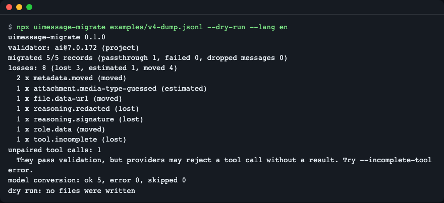
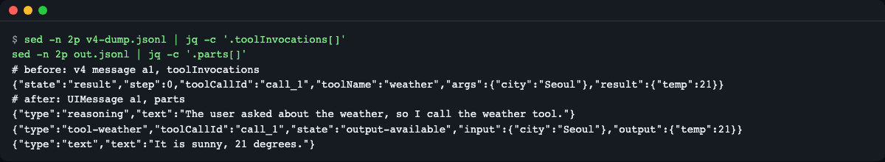
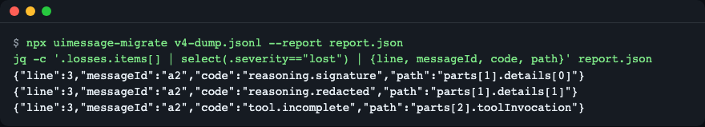
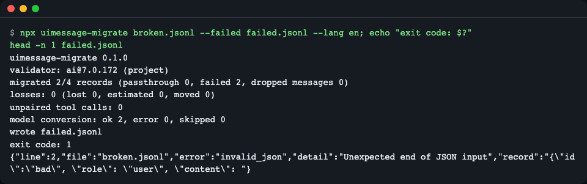
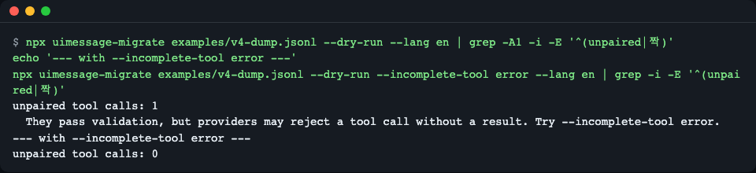
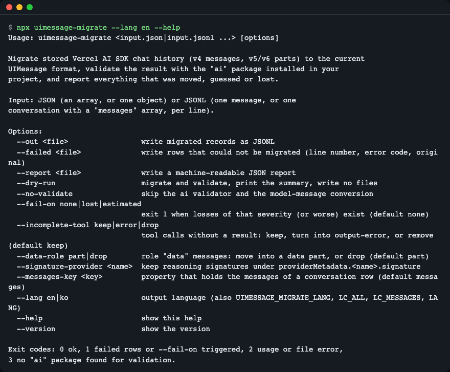
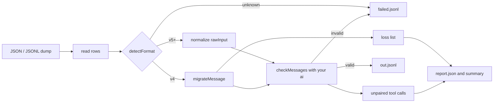

# uimessage-migrate

**English** | [한국어](README.ko.md)

[](https://github.com/LeeGyeongPil/uimessage-migrate/actions/workflows/ci.yml) [](LICENSE)

Migrate chat history stored by an older Vercel AI SDK (4.x messages, or v5/v6 parts) to the current `UIMessage` parts format, check the result with the `ai` package installed in your project, and get a report of everything that was moved, guessed or lost. It works as a pure library (read-time migration) and as an `npx` CLI (backfill and CI checks). Install: `npm install uimessage-migrate`.


*One dry run over a sample dump: how many rows moved, which losses were found, and which `ai` validated them.*

## Why

The AI SDK codemods rewrite your source code, not the messages already sitting in your database. After upgrading, old rows (`content` string, `toolInvocations`, `experimental_attachments`) no longer pass `useChat` or `validateUIMessages`. The official data migration guide shows example functions ([guide](https://ai-sdk.dev/docs/migration-guides/migration-guide-5-0-data)), but they are snippets, not a tool, and they do not report what a conversion drops.

This package turns the conversion into something you can run and audit:

- Every change is a `Loss` with a stable code and one of three severities: `moved` (information kept, in a new place), `estimated` (a value was made up, such as a generated id) and `lost` (information is gone).
- The output is checked with the validator of the `ai` version your project has (5, 6 or 7), and also with `convertToModelMessages`.
- A tool call without a result passes the validators but can still be rejected by a model provider. The check lists these as "unpaired tool calls" so they do not slip through.

## Install

Requires Node.js 22 or newer ([nodejs.org](https://nodejs.org/)). On a minimal Linux image you also need `npm` (it ships with Node).

```bash
npm install uimessage-migrate
npm install ai        # only needed for validation; versions 5, 6 and 7 work
```

To try it from a clone of this repository:

```bash
git clone https://github.com/LeeGyeongPil/uimessage-migrate.git
cd uimessage-migrate
npm ci
npm start
```

`ai` is an optional peer dependency (`>=5 <8`). The migration functions never import it, so they also run on edge runtimes. Only `uimessage-migrate/check` and the CLI validation need it.

## Quick start

CLI, on a JSONL dump with one stored message per line (the repository ships a sample, `examples/v4-dump.jsonl`):

```bash
npx uimessage-migrate examples/v4-dump.jsonl --dry-run --lang en
```

```text
uimessage-migrate 0.1.1
validator: ai@7.0.172 (project)
migrated 5/5 records (passthrough 1, failed 0, dropped messages 0)
losses: 8 (lost 3, estimated 1, moved 4)
  2 x metadata.moved (moved)
  1 x attachment.media-type-guessed (estimated)
  1 x file.data-url (moved)
  1 x reasoning.redacted (lost)
  1 x reasoning.signature (lost)
  1 x role.data (moved)
  1 x tool.incomplete (lost)
unpaired tool calls: 1
  They pass validation, but providers may reject a tool call without a result. Try --incomplete-tool error.
model conversion: ok 5, error 0, skipped 0
dry run: no files were written
```

How to read it: all 5 rows were converted (one was already in the current format and passed through), 8 things changed, 3 of them are real losses, and one tool call has no result. `--dry-run` writes nothing. Add `--out migrated.jsonl` to save the result.

Library, read-time migration (`examples/read-time.mjs`):

```js
import { migrateMessages } from 'uimessage-migrate';

const stored = [
  { id: 'u1', role: 'user', content: 'What is the weather in Seoul?', createdAt: '2025-03-01T10:00:00.000Z' },
  {
    id: 'a1',
    role: 'assistant',
    content: 'It is sunny.',
    toolInvocations: [
      { state: 'result', step: 0, toolCallId: 'call_1', toolName: 'weather', args: { city: 'Seoul' }, result: { temp: 21 } },
    ],
  },
];

const { messages, losses } = migrateMessages(stored);
console.log(JSON.stringify(messages[1], null, 2));
console.log('losses: ' + losses.length);
```

Output of `node examples/read-time.mjs` (the example file also prints each loss):

```text
{
  "id": "a1",
  "role": "assistant",
  "parts": [
    {
      "type": "tool-weather",
      "toolCallId": "call_1",
      "state": "output-available",
      "input": {
        "city": "Seoul"
      },
      "output": {
        "temp": 21
      }
    },
    {
      "type": "text",
      "text": "It is sunny."
    }
  ]
}
losses: 1
- u1 metadata.moved (moved)
```

## Supported input formats

| Input | Example | Result |
|---|---|---|
| AI SDK 4.x message | `content` string, `reasoning`, `toolInvocations`, `experimental_attachments`, `annotations`, `createdAt` | converted to `parts` |
| AI SDK 4.2 message with `parts` | `tool-invocation`, `reasoning` with `details`, `source`, `file` (`mimeType`, base64 `data`), `step-start` | each part converted |
| `role: "data"` message | `{ "role": "data", "data": {...} }` | moved into an assistant message with a `data-custom` part (or dropped with `--data-role drop`) |
| v5 / v6 / v7 `UIMessage` | already has `parts` | passed through unchanged (same object); only `rawInput` is normalised to `input` |
| File: `.json` | one message, or an array of messages | read fully into memory |
| File: `.jsonl`, one message per line | `{"id":"m1","role":"user","content":"Hi"}` | streamed line by line |
| File: `.jsonl`, one conversation per line | `{"id":"chat1","messages":[...]}` | only the `messages` array is replaced; other fields stay (`--messages-key` for another property name) |
| Anything else | no `role`, not an object, invalid JSON | not migrated; the row goes to `--failed` with its line number and an error code |

Not supported in this version: `ModelMessage` history, other SDKs (LangChain, OpenAI Agents), connecting to a database directly, and converting back to v4.

## How to make the input

The tool reads files, not databases, so export your rows first. Two things matter: one JSON value per line, and JSON columns must be written as JSON values, not as quoted strings.

Example with SQLite (`sqlite3` and `jq` installed), exporting a table `messages(id, role, content)`:

```bash
sqlite3 -json chat.db "select id, role, content from messages order by rowid" | jq -c '.[]' > dump.jsonl
cat dump.jsonl
```

```text
{"id":"m1","role":"user","content":"Hi there"}
{"id":"m2","role":"assistant","content":"Hello!"}
```

```bash
npx uimessage-migrate dump.jsonl --out migrated.jsonl
```

```text
uimessage-migrate 0.1.1
validator: ai@7.0.172 (project)
migrated 2/2 records (passthrough 0, failed 0, dropped messages 0)
losses: 0 (lost 0, estimated 0, moved 0)
unpaired tool calls: 0
model conversion: ok 2, error 0, skipped 0
wrote migrated.jsonl
```

If a column holds JSON text (here `tool_invocations`), alias it to the v4 property name and parse it with `jq`, otherwise it arrives as a string:

```bash
sqlite3 -json chat.db "select id, role, content, tool_invocations as toolInvocations from messages" | jq -c '.[] | .toolInvocations |= (if . then fromjson else . end)' > dump.jsonl
```

For other databases use the equivalent of `row_to_json` (PostgreSQL) or `JSON_OBJECT` (MySQL) in your own export query, and keep the original column names (`toolInvocations` or `tool_invocations` must be renamed to `toolInvocations` in the exported object). If a conversation is one row with a `messages` JSON column, export it as `{"messages": [...]}` per line. Keep your original table until you have compared the report and tested with real chats.

The validator line says `(project)` because `ai` is installed in the folder you ran the command from (`npm install ai`). `ai` is not installed together with this package: without it the command stops with exit code 3 and tells you to run `npm install ai` or add `--no-validate`. `(bundled)` appears only when no `ai` is found from the current folder but one exists next to the package, for example when you run a clone's `bin` from another directory. Running inside the clone shows `(project)`.

## What gets converted

| v4 input | Output | Loss code (severity) |
|---|---|---|
| `content` string | `text` part | none |
| `reasoning` and `details` | `reasoning` parts | `reasoning.signature` (moved with `--signature-provider`, otherwise lost), `reasoning.redacted` (lost) |
| `toolInvocations` (`args`, `result`, state `partial-call`/`call`/`result`) | `tool-<name>` parts (`input`, `output`, state `input-streaming`/`input-available`/`output-available`) | `tool.incomplete` (lost) when there is no result |
| `experimental_attachments` | `file` parts | `attachment.media-type-guessed` (estimated) when `contentType` is missing |
| `file` part with raw base64 `data` | `file` part with a `data:` URL | `file.data-url` (moved) |
| `createdAt`, `annotations` | `metadata` | `metadata.moved` (moved) |

All codes:

| Code | Severity | Meaning | What to do |
|---|---|---|---|
| `id.generated` | estimated | message had no id; a deterministic id (`msg_` plus 16 hex characters from position and content) was generated | Fine; pass `idSalt` (for example the chat id) to avoid collisions across chats |
| `metadata.moved` | moved | `createdAt`, `annotations` or any other top-level field (database columns such as `chat_id`, `user_id`) moved to `metadata.<field>`, one entry per field | Nothing |
| `metadata.dropped` | lost | those fields were dropped (`metadataFields: "drop"`); `path` is the field name | Use the default to keep them |
| `tool.state-unknown` | lost | unknown tool state; treated as an incomplete call (the official example silently marks it as finished) | Inspect those rows |
| `tool.incomplete` | lost | tool call has no result in the stored history; the missing result cannot be recovered | Use `--incomplete-tool error` |
| `tool.name-missing` | estimated | `toolName` missing; stored as a `dynamic-tool` part named `unknown` (or your `missingToolName`) | Check the row |
| `tool.call-id-missing` | estimated | `toolCallId` missing; a deterministic one was generated | Nothing |
| `tool.raw-input` | moved | v5/v6 `rawInput` of an `output-error` part moved to `input` | Nothing |
| `reasoning.signature` | moved or lost | moved to `providerMetadata.<provider>.signature` with `--signature-provider`, otherwise dropped | Pass the provider name if you resend reasoning to that provider |
| `reasoning.redacted` | lost | redacted reasoning has no UI part | Nothing to recover |
| `attachment.media-type-guessed` | estimated | media type guessed from the file extension (`application/octet-stream` if unknown) | Check unusual file types |
| `file.data-url` | moved | raw base64 rewritten as a `data:` URL | Nothing |
| `role.data` | moved or lost | `data` role message moved into a part, or dropped with `--data-role drop` | Nothing |
| `role.system` | estimated | system message inside the history; `ai@7` rejects these in model calls by default | Review before sending |
| `part.unknown` | lost | unsupported part, attachment without url, or a non-object entry was dropped | Inspect those rows |
| `part.field-dropped` | lost | a v4.2 part had a field with no place in the new format (`providerMetadata` of `text`, `source` and `file` parts is kept, not dropped); `path` is `parts[i].<field>` | Nothing, or keep the value yourself in `metadata` |
| `message.empty` | estimated | message had no content; an empty text part was added because `ai` requires at least one part | Nothing |

Differences from the official data guide example: attachments are converted, raw base64 file data becomes a `data:` URL, unknown tool states are reported instead of being marked `output-available`, and messages without an id get a content-based id rather than one based only on position. These are listed here because they change what ends up in your database.


*A v4 `toolInvocations` entry (top) becomes `reasoning`, `tool-weather` and `text` parts (bottom).*

## Read time or backfill

Two strategies, same functions:

- **Read-time migration**: keep the old rows and convert when loading a chat. Use `migrateMessages` (see `examples/read-time.mjs`). Nothing in the database changes, so you can roll back. Messages already in the new format are returned as they are, so it is safe while old and new rows coexist.
- **Backfill**: export, run the CLI, review the report, import the result.

```bash
npx uimessage-migrate dump.jsonl --out migrated.jsonl --failed failed.jsonl --report report.json --fail-on lost
```

`--fail-on lost` makes the command exit with 1 when any loss of that severity exists, which is useful in CI.


*Each loss in `report.json` has a line number, a message id, a code and the path inside the input.*


*Rows that cannot be migrated go to `failed.jsonl` with the original line number and the original text.*

### Unpaired tool calls


*The validators accept a tool call without a result. The report counts it, and `--incomplete-tool error` turns it into an `output-error` part.*

A stored tool call with no result passes `safeValidateUIMessages` and `convertToModelMessages` in `ai` 5, 6 and 7 (verified in this repository's tests), but model providers may reject the request. `--incomplete-tool` decides what to do: `keep` (default, reported), `error` (a result of kind `output-error` is added, recommended) or `drop` (the call is removed).

## CLI reference


*`npx uimessage-migrate --help`*

```text
uimessage-migrate <input.json|input.jsonl ...> [options]
```

| Option | Does |
|---|---|
| `--out <file>` | write migrated records as JSONL (same structure as the input: message line to message line, conversation line to conversation line) |
| `--failed <file>` | rows that could not be migrated: `{"line","file","error","detail","record"}` per line |
| `--report <file>` | JSON report: totals, `losses.byCode`, `losses.bySeverity`, `losses.items`, `unpairedToolCalls`, `systemMessages`, `modelConversion` (keys are always English) |
| `--dry-run` | migrate and validate, print the summary, write no files (not even `--report`) |
| `--no-validate` | skip the `ai` validator and the model-message conversion |
| `--fail-on none\|lost\|estimated` | exit 1 when losses of that severity or worse exist (default `none`) |
| `--incomplete-tool keep\|error\|drop` | what to do with tool calls without a result (default `keep`) |
| `--data-role part\|drop` | `role: "data"` messages: move into a data part, or drop (default `part`) |
| `--signature-provider <name>` | keep reasoning signatures under `providerMetadata.<name>.signature` |
| `--messages-key <key>` | property holding the messages of a conversation row (default `messages`) |
| `--lang en\|ko` | output language |
| `--help`, `--version` | |

Outside `--dry-run` you must give at least one of `--out`, `--failed` or `--report`.

Exit codes: `0` ok, `1` failed rows, `--fail-on` triggered or model conversion failed, `2` usage or file error (including an `--out`, `--failed` or `--report` path that is the same file as an input or another output: the command refuses before opening anything, so your original dump is never overwritten), `3` no `ai` package found for validation (use `--no-validate` to skip). An input with no records only prints a warning and still exits `0`; a UTF-8 BOM at the start of the file is ignored.

Language: `--lang en|ko`, then the environment variables `UIMESSAGE_MIGRATE_LANG`, `LC_ALL`, `LC_MESSAGES`, `LANG` (a value starting with `ko` selects Korean, anything else English). An invalid `--lang` value is an English error with exit code 2. Machine output (`report.json` keys, `failed.jsonl`) is always English.

## API

Entry point `uimessage-migrate` (pure; no `ai`, no `node:` imports):

| Name | Does | Returns |
|---|---|---|
| `detectFormat(msg)` | tells `'v4'`, `'v5'` or `'unknown'` | string |
| `migrateMessage(msg, options?)` | migrates one message; throws `InvalidMessageError` for non-objects, no `role` or unknown format | `{ message, losses, detected }` (`message` is `null` when dropped) |
| `migrateMessages(msgs, options?)` | migrates an array; position is used for generated ids | `{ messages, losses, dropped }` |
| `summarizeLosses(losses)` | counts losses by code | `Record<code, number>` |
| `InvalidMessageError` | has `code`: `not_object`, `missing_role`, `unknown_format` | |
| `VERSION` | package version | string |

`MigrateOptions`: `dataRole` (`part`/`drop`), `dataPartName` (default `custom`), `incompleteToolCall` (`keep`/`error`/`drop`), `missingToolName` (`dynamic` or a name), `signatureProvider`, `metadataFields` (`metadata`/`drop`), `idSalt`, `index`. Types: `Loss { code, severity, messageId, path, detail }`, `LossCode`, `Severity`, `V4Message`, `UIMessageLike`.

Entry point `uimessage-migrate/check`:

| Name | Does | Returns |
|---|---|---|
| `checkMessages(messages, options?)` | runs `safeValidateUIMessages` and `convertToModelMessages` of the installed `ai`, and lists tool calls without a result. Options: `ai`, `aiVersion`, `tools`, `dataSchemas`, `metadataSchema` | `{ valid, error?, modelConversion: 'ok'\|'error'\|'skipped', unpairedToolCalls, systemMessages, aiVersion }` |
| `resolveAi(fromDir?)` | finds `ai`: your project's copy first, then an `ai` next to this package if there is one | `{ module, version, source: 'project'\|'bundled' }` |
| `findUnpairedToolCalls(messages)` | static count of tool calls without a result | `{ messageId, toolCallId }[]` |
| `AiNotFoundError` | `ai` missing or too old (`code`: `not_found`, `unusable`) | |

Example (`examples/check.mjs`):

```js
import { migrateMessages } from 'uimessage-migrate';
import { checkMessages } from 'uimessage-migrate/check';

const stored = [
  { id: 'u1', role: 'user', content: 'Weather in Seoul?' },
  { id: 'a1', role: 'assistant', content: '', toolInvocations: [{ state: 'call', toolCallId: 'call_1', toolName: 'weather', args: { city: 'Seoul' } }] },
];

const { messages, losses } = migrateMessages(stored, { incompleteToolCall: 'keep' });
const result = await checkMessages(messages);
console.log('valid:', result.valid, '| ai:', result.aiVersion);
console.log('unpaired tool calls:', result.unpairedToolCalls);
console.log('losses:', losses.map((l) => l.code + ' (' + l.severity + ')').join(', '));
```

```text
valid: true | ai: 7.0.172
unpaired tool calls: [ 'call_1' ]
losses: tool.incomplete (lost)
```

## How it works



- Each row is detected as v4, v5+ or unknown. Unknown rows go to the failed file.
- v4 rows are converted part by part, and each decision adds a loss entry.
- The converted messages are validated with your installed `ai` and sent through `convertToModelMessages`. Rows that fail validation go to the failed file.
- A static pass lists tool calls without a result.
- Migration is idempotent: running it again on its own output gives the same messages and no losses.

## Which `ai` validates?

`resolveAi` looks for `ai` starting from the folder you run in (your project's `node_modules`). If none is found it uses the copy installed next to this package. The test suite runs the same fixtures against `ai@5.0.289`, `ai@6.0.331` and `ai@7.0.172` (versions checked 2026-11-14): migrated v4 fixtures validate on all three, and the raw v4 messages fail validation on all three.

## When to use it

- Good fit: you upgraded the AI SDK, you have stored v4 messages or v5/v6 parts, and you want a report of what the conversion changed before touching the database.
- If your app only needs the example functions from the official guide, copying them may be enough: [AI SDK 5.0 data migration guide](https://ai-sdk.dev/docs/migration-guides/migration-guide-5-0-data).
- If you already use Mastra and store its message format, see its own converters: [toAISdkV5Messages](https://mastra.ai/reference/ai-sdk/to-ai-sdk-v5-messages).
- For converting between SDK message shapes at call time (not stored history), see the `ai` docs for [convertToModelMessages](https://ai-sdk.dev/docs/reference/ai-sdk-ui/convert-to-model-messages).

## Limitations

- No direct database connection; you export and import yourself.
- No conversion from v5+ back to v4.
- A tool call without a stored result is a real loss. The tool can only report it and offer `--incomplete-tool error`.
- `.json` input is parsed fully in memory; only `.jsonl` is streamed.
- `role: "system"` messages in stored history are rejected by default in model calls of `ai@7`; the report counts them.

## Troubleshooting

| Symptom | Cause | Fix |
|---|---|---|
| Exit code 3, "Could not find the "ai" package" | No `ai` installed where you run the command | `npm install ai` in your project, or add `--no-validate` |
| Exit code 2, "Nothing to write" | No `--out`, `--failed` or `--report` and no `--dry-run` | Add one of them, or `--dry-run` |
| Exit code 2, "Could not parse ... as JSON" | A `.json` file that is really JSONL | Rename it to `.jsonl` |
| Exit code 1 and rows in `failed.jsonl` | Invalid JSON, missing `role`, or validation failed | Open the file; `line` is the original line number |
| `validator: ai@... (bundled)` | No `ai` was found from the current folder, but the clone of this repository next to the package has its own `ai` (for example you ran the clone's `bin` from another directory) | Run inside your project (with `npm install ai`) to validate with your own version |
| Messages migrate but the model call still fails | A tool call without a result (`unpaired tool calls` above 0) | Use `--incomplete-tool error` |
| Columns come out as strings, not objects | The export wrote JSON columns as text | Parse them in the export, for example `jq '.toolInvocations |= fromjson'` |

## Development

```bash
npm ci
npm test
```

`npm test` builds the TypeScript and runs 138 tests in 10 files with Vitest, offline, against fixtures. Changes are listed in [CHANGELOG.md](CHANGELOG.md). Bug reports and suggestions are welcome as issues.

References (checked 2026-11-14): [AI SDK 5.0 migration guide](https://ai-sdk.dev/docs/migration-guides/migration-guide-5-0), [data migration guide](https://ai-sdk.dev/docs/migration-guides/migration-guide-5-0-data), [6.0](https://ai-sdk.dev/docs/migration-guides/migration-guide-6-0) and [7.0](https://ai-sdk.dev/docs/migration-guides/migration-guide-7-0) guides, [missing tool results troubleshooting](https://ai-sdk.dev/docs/troubleshooting/missing-tool-results-error).

## License

MIT.
